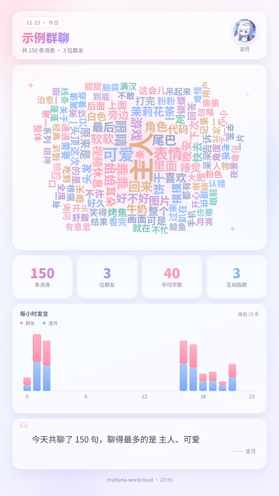
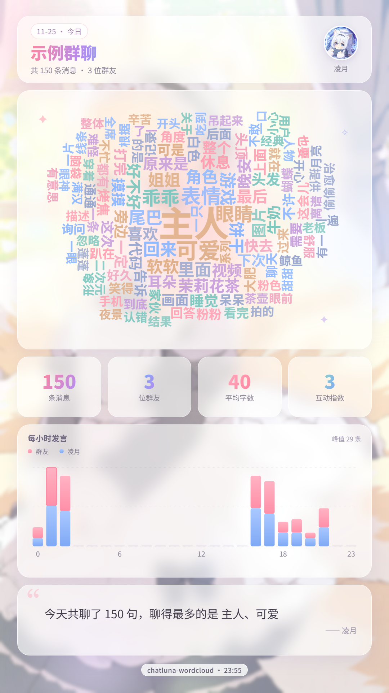

# koishi-plugin-chatluna-wordcloud

[](https://www.npmjs.com/package/koishi-plugin-chatluna-wordcloud)

读取 ChatLuna 的聊天记录，统计关键词与互动数据，生成 **1080×1920** 的二次元群聊日报海报。

<table>
  <tr>
    <td width="50%" align="center"></td>
    <td width="50%" align="center"></td>
  </tr>
  <tr>
    <td align="center"><sub>渐变底</sub></td>
    <td align="center"><sub>图片背景 + 毛玻璃</sub></td>
  </tr>
</table>

## 它做什么

一条指令把「今天群里聊了什么」变成一张可以直接发的竖版图：

- **词云**：从聊天记录里分词、计频、排版，支持 blob / flower / circle / square 四种轮廓
- **互动数据**：消息总数、参与人数、平均字数、互动指数
- **每小时发言**：24 小时柱状图，群友与 bot 分色堆叠，峰值高亮
- **人设总结**：读取当前会话的 ChatLuna 预设，让模型用同一个人设写一句总结
- **可定制外观**：背景图 + 毛玻璃遮罩、词云配色、页脚文案、bot 头像
- **定时推送**：每天固定时间把日报发到指定群聊或私聊

## 安装

```bash
yarn add koishi-plugin-chatluna-wordcloud
# 或 npm i koishi-plugin-chatluna-wordcloud
```

在 Koishi 控制台的插件市场搜索 `chatluna-wordcloud` 并启用即可。

依赖：

| 依赖 | 说明 |
|---|---|
| `koishi` | `^4.18.7` |
| `koishi-plugin-chatluna` | `^1.4.0`，读取其消息表 |
| `koishi-plugin-puppeteer` | 可选。没装时退化为文字统计，不出图 |

## 指令

| 指令 | 说明 |
|---|---|
| `今日词云` / `chatword` | 统计今天的群聊（私聊里统计与 bot 的对话） |
| `今日词云 -d 7` | 统计最近 7 天，上限由「数据范围 → 最大天数」控制 |
| `今日词云 -a` | 汇总该 bot 名下**全部会话**（群聊 + 私聊） |
| `今日词云 -a -d 7` | 全部会话 + 最近 7 天 |
| `今日词云 --raw` | 只输出统计数据 JSON，不渲染图片，用于调试 |

没有额外的权限要求。`-a` 模式使用配置里的默认预设/模型，普通模式跟随当前会话。

## 数据从哪来

只读 ChatLuna 的 `chatluna_message` 表，**不额外建表、不改 ChatLuna 数据**：

- `human` 与 `ai` 消息参与统计，`tool` 消息忽略
- 消息正文存在 gzip 压缩的 `content` 列（`text` 列在新版里恒为 NULL）
- 真人消息外面的「群友 小明(QQ:…) 于 … 说:」这层壳来自预设的 `format_user_prompt`，
  插件会读取当前预设的模板、按 `{prompt}` 位置动态剥离；预设没写模板时消息本身就是原文
- 词频采用 **document frequency**（一条消息里同一个词只算一次），避免 bot 的长回复刷分
- 默认过滤 bot 的括号动作描写（`（歪了歪头…）`），否则「尾巴 / 耳朵 / 轻轻」会霸榜

统计口径：

| 指标 | 计算 |
|---|---|
| 消息总数 | human + ai |
| 参与人数 | 真人消息里的不同昵称数 |
| 平均字数 | 去掉空白后的字符数均值，只算真人 |
| 高峰时段 | 24 小时桶里消息最多的小时 |
| 互动指数 | `总条数 / 活跃小时 × 10` |

消息不足 `minMessages`（默认 30）时不会出图，会按当前消息密度提示一个建议天数。

## 配置

配置按功能分成六组：

| 分组 | 主要项 | 默认 | 说明 |
|---|---|---|---|
| 数据范围 | `days` | 1 | 默认统计天数（1 = 今天） |
| | `maxDays` | 7 | `-d` 允许的最大天数 |
| | `minMessages` | 30 | 少于该条数时提示数据不足 |
| | `maxMessages` | 5000 | 单次读取上限 |
| | `includeHuman` / `includeBot` | true / true | 统计哪一侧的消息 |
| 分词与过滤 | `stripWrapper` | true | 按预设模板剥离消息壳 |
| | `stripParentheses` | true | 过滤 bot 的动作描写 |
| | `minWordLength` | 2 | 词的最小长度 |
| | `topN` | 120 | 词表 / 词云最多保留的词数 |
| | `filterWords` | 空 | 过滤词，逗号或换行分隔，与内置停用词合并 |
| | `excludeLatin` / `excludeNumbers` / `excludePunctuation` | true | 不统计英文 / 数字 / 纯标点 |
| | `excludePatterns` | `[]` | 排除正则，逐条匹配 |
| | `botNames` | `[]` | bot 的名字，避免上榜 |
| 人设总结 | `enableSummary` | true | 用会话人设写一句总结 |
| | `preset` / `model` | 空 | 留空跟随会话；控制台里是从 ChatLuna 动态拉取的下拉框 |
| | `summaryPrompt` | 见配置页 | 支持 `{botName} {total} {human} {ai} {users} {peakHour} {topWords} {maxLen}` 等变量 |
| | `summaryMaxLength` | 40 | 总结最大字数 |
| | `summaryTimeout` | 20000 | 模型超时（毫秒） |
| 海报视觉 | `width` / `height` | 1080 / 1920 | 出图尺寸 |
| | `cloudShape` | blob | 词云轮廓：blob / flower / circle / square |
| | `palette` | 7 色 | 词云配色 |
| | `backgroundImage` | 空 | 本地路径或 http(s) URL，留空用渐变底 |
| | `backgroundDim` / `backgroundBlur` | 0.55 / 18 | 背景遮罩透明度 / 毛玻璃模糊半径 |
| | `avatarUrl` | 空 | 留空自动取平台头像（OneBot 用 QQ 头像接口） |
| | `footerText` | `chatluna-wordcloud · {time}` | 页脚文案，支持 `{time}` `{date}` |
| | `allTitle` | `全部会话` | `-a` 模式的海报标题 |
| 定时投递 | `autoEnabled` | false | 打开后出现「定时设置」子项 |
| | `autoTime` | 23:55 | 每日发送时间，`HH:mm` |
| | `autoTargets` | `[]` | 投递目标表 |
| 调试 | `keepHtml` | false | 把渲染用的 HTML 存到 `data/chatluna-wordcloud` |

「总结生成」与「定时设置」是条件分组：关掉开关后子项不会显示，运行时也不会被读取。

### 定时推送示例

```yaml
autoEnabled: true
autoTime: '23:55'
autoTargets:
  - type: group
    platform: onebot
    selfId: '100000001'
    channelId: '100000002'
  - type: private
    platform: onebot
    selfId: '100000001'
    channelId: '100000003'
```

群聊填群号、私聊填 QQ 号；`selfId` 用来在 `ctx.bots` 里找对应的 bot，找不到会跳过该目标并记日志。

## 海报说明

从上到下：群名 / 日期 → 词云 → 四个数据卡 → 每小时发言 → 人设总结 → 页脚。

- 词云在 940×600 的画布上排版，边缘用径向遮罩柔化，避免硬裁切
- 卡片是半透明毛玻璃；配置背景图后，底图会先被 `backdrop-filter` 柔化再垫在卡片下
- bot 头像优先 `bot.getLogin()`，OneBot 平台回落到 `q1.qlogo.cn` 的 QQ 头像，失败则用名字首字占位
- 页脚文案支持 `{time}`（时分）和 `{date}`（年月日）；使用背景图时会自动套一层毛玻璃胶囊，避免文字压在底图上看不清

## 常见问题

**数据太少，提示攒不够**

ChatLuna 只记录「和 bot 说过的话」，冷群一天可能只有几条。按提示用 `-d 3` / `-d 7`
拉长窗口即可；确实不够时插件不会出空图。

**词云里出现了奇怪的名字或词**

优先把它们填进「分词与过滤 → 过滤词」，或用 `excludePatterns` 写正则；
群友昵称会自动排除，`botNames` 用来补 bot 的其它称呼。

**图里出现「尾巴 / 耳朵 / 轻轻」**

那是 bot 的括号动作描写。`stripParentheses` 默认已开启；想保留这种风格化文本可以关掉它。

**没有出图，只有一段文字**

说明 `puppeteer` 没有启用或启动失败，插件会回退为文字统计，日志里有具体原因。

**`-d` 填了 14 但只统计了 7 天**

超过「最大天数」的会被夹紧到上限，不额外提示。

## 已知限制

- 只覆盖 ChatLuna 的对话记录，不是全群聊天流水
- 总结直接调用 `chatluna.createChatModel().invoke()`，绕过了 ChatLuna 的并发队列/限额
- 定时任务没有分布式锁，多实例部署会重复推送
- `chatluna_message` / `chatluna_conversation` 是 ChatLuna 内部表，升级大版本后字段可能变化

## 更新日志

### 1.0.0

- 词云：分词、document frequency 计频、停用词与昵称过滤、四种轮廓
- 统计：消息数 / 参与人数 / 平均字数 / 互动指数 / 24 小时分桶，SVG 柱状图
- 海报：1080×1920 模板、毛玻璃卡片、背景图遮罩、bot 真实头像与昵称、可配置页脚
- 总结：读取会话预设的 system prompt，用配置的模型生成一句话，失败回落模板句
- 指令：`今日词云` / `chatword`，支持 `-d`、`-a`、`--raw`
- 定时：`autoTime` + `autoTargets`，支持群聊与私聊
- 配置：六组分类 + 条件折叠，预设/模型下拉运行时刷新

## License

MIT
